# Visual audit: phases 3 and 4

The end-of-phase audit from `docs/briefs/visual-audit.md`, taken on 13 October 2026. The full set was shot on `main` at 0c558bc (after Stockport's re-lay, bb2d83e). While it was being written up, the real buildings along today's line (dbdb163), the Buxton line's first stations (2d398f9) and the Marple line's track (92ce2fc) landed, so a final pass was started on that `main`; the owner wound the sessions down part-way through it, so it covers the stations, the line at phone size and the page's surfaces, but not the places, the line at desktop size or the light and weather sample (see "What the final pass didn't cover").

**How it was taken.** `npm run build`, then `node tools/shots.mjs --audit`: 263 shots in `build/shots/audit/` with contact sheets in `build/shots/audit/sheets/`. The game is fully upgraded through the sim (every station and stage, every line upgrade, every perk, a renewed contract, the car parks filled), with a unit of every service standing at each station's platforms, six-car units and the expresses among them. Each station from its platform, above, the north and south approaches and its street side; the line every 400 m along both corridors; the junctions, the landmarks, the viaduct from the valley and the deck, and the skyline; a sample at dusk, at night (with the engineering train), in rain, snow and fog; all at 390 px and 1440 px; and the page's surfaces at 320 px. Every shot was looked at. Only the shots of findings are kept here, at half size, with one overview: `phase-3-4/overview.jpg`.

**How bad.** *Straight away*: a player would notice it without looking for it. *Closely*: only looking closely. *To check*: unclear whether it's wrong, so the fixing session looks first.

Known gaps in phases 3 to 5's "Later" notes (the city's towers as plain blocks, Hazel Grove's carriage sidings, Heaton Chapel's and Davenport's car parks, the M60 as a stand-in) aren't listed. Phase 5's real surroundings (step 10) will replace the suburb houses, the stand-in town and the roads' ground cover; findings it would sweep away are marked so, and are still worth a look when it lands.

## Being fixed: track spacing (checked)

The track spacing fix (c747a1d, bb2d83e) has landed. From the deck and from Stockport's south end, the four main lines now run onto the viaduct in order on parallel tracks, with no long diagonals and no pairs hanging off the side. Piccadilly's throat is still on the layout test's list (phase 5, step 1). One thing to check on the viaduct is below (finding 12).

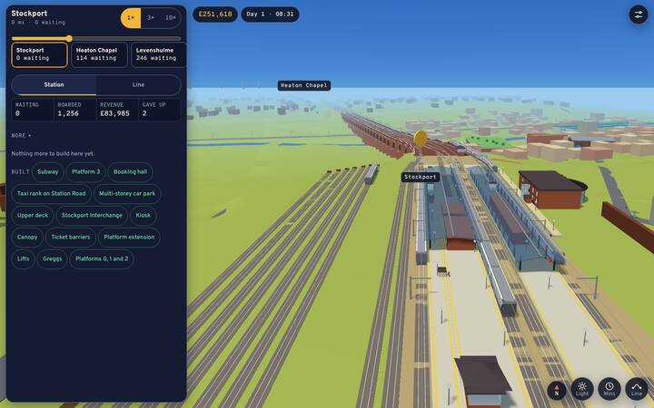

## What the real buildings changed

The final pass, with OpenStreetMap's buildings along today's line, settles two of the findings below and adds one:

- **Gone:** the tall brown pillars round Ardwick and Piccadilly (finding 2) and the scattered houses overlapping one another (part of finding 3). Grown homes still show as roofless red boxes among the roofed real buildings in places (Woodsmoor, Hazel Grove), which is finding 8's house.
- **Still there:** the roads breaking up (finding 1), the block hanging over the valley by the viaduct (finding 3), the cutting walls (5), Hazel Grove's bus on the grass (7), the names overlapping (10), the Revenue cut off (4).
- **New, to check:** the real buildings and the stand-in roads don't agree: buildings stand across the grey road slabs (Heaton Chapel's street side), and a tree stands on a flat roof between Levenshulme and Ardwick. The roads are from memory and the buildings from OpenStreetMap, so it's the roads that are wrong; phase 5 steps 8 and 9 redraw them.

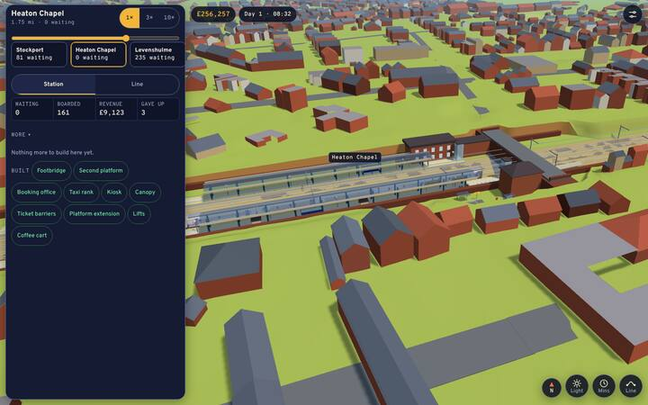
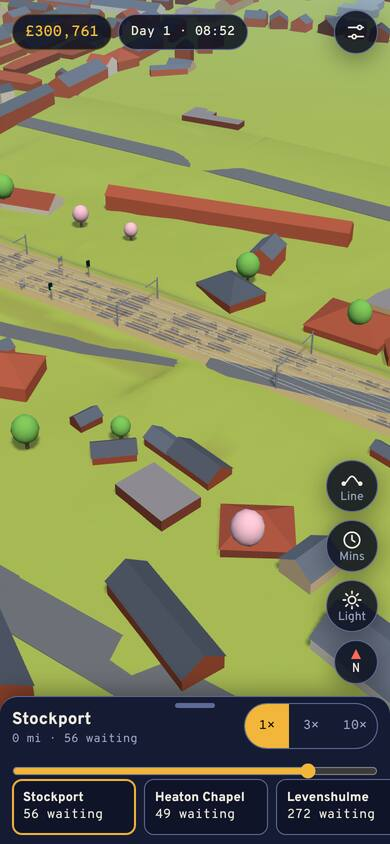
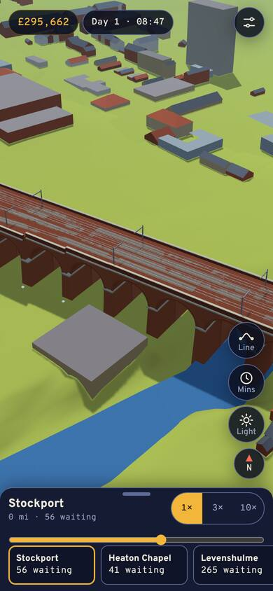
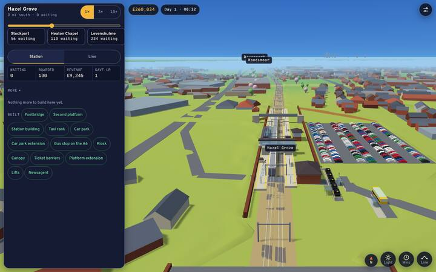

**For the Buxton line's session, not a phase 3 or 4 finding:** at Middlewood a long brown bridge slab crosses the station high and at an angle, with no road or path onto either end.

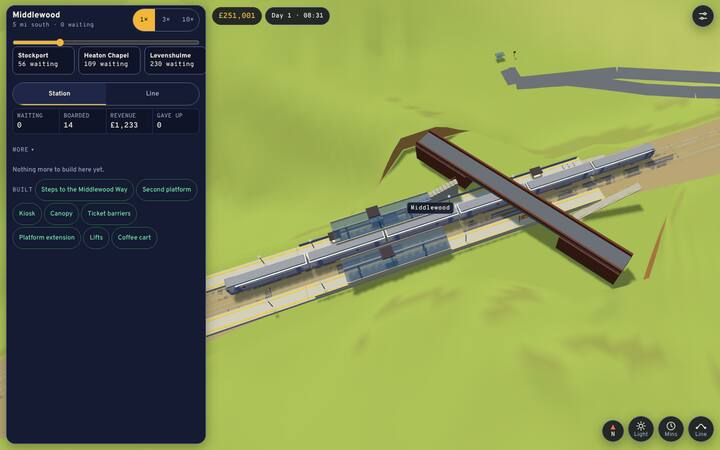

## Findings, most visible first

### 1. Roads break into pieces and miss their bridges
Straight away. All along the line: the roads are drawn as grey ribbons that stop in the middle of fields, break into separate slabs where the ground rises over them, and don't meet the road bridges over the line (Woodsmoor, Davenport, Heaton Chapel), so a bridge stands with no road onto it. Phase 5 steps 8 to 10 redraw the roads; until then this is the first thing a player sees between stations.

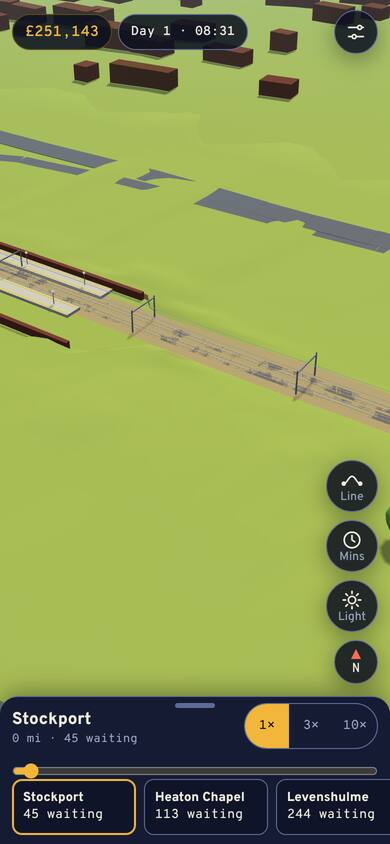
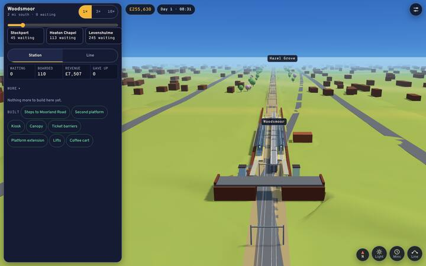
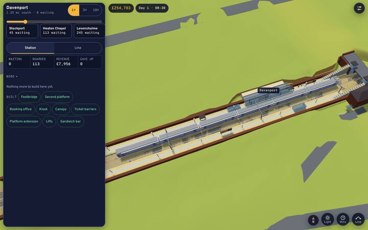

### 2. Tall brown pillars round Ardwick and Piccadilly
Gone with the real buildings (final pass); kept for the record. Straight away. Grown homes near the city end stand as very tall, thin, plain brown boxes, much taller than anything else outside the city centre, so from the south the approach to Piccadilly looks like a field of chimneys. Real surroundings (step 10) replaces them.

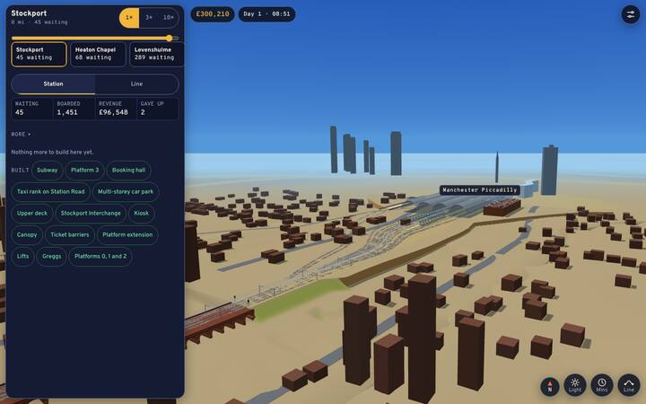

### 3. Houses overlap each other and roads, and float over the valley
Straight away near the viaduct, closely elsewhere. Grown homes overlap one another and stand across the roads (between Heaton Chapel and Levenshulme), and the stand-in town's blocks on the valley side hang in the air over the slope beside the viaduct. Real surroundings (step 10) replaces both; until then, homes should keep off roads and sit on the ground.

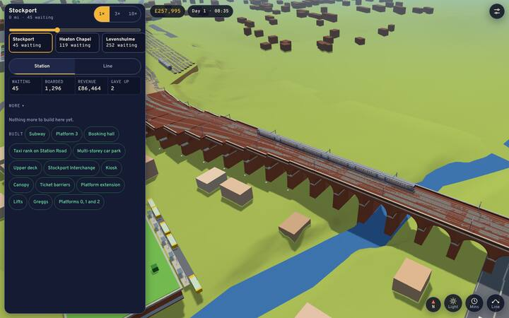

### 4. A station's takings are cut off in its panel
Straight away. The Revenue figure is cut with an ellipsis once it has six figures: "£83,3…" at 320 px, and "£17,600…" even on a desktop once a game runs into weeks. The number a player most wants to read is the one that's lost.

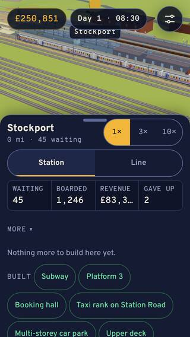
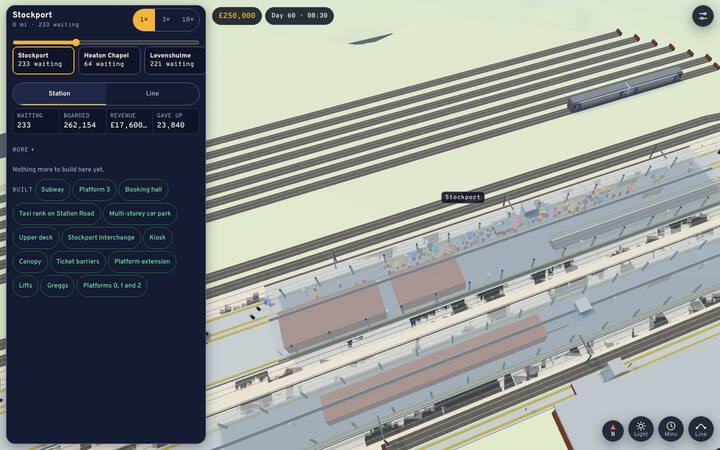

### 5. The cutting walls stand out of flat ground
Straight away, to check. At Heaton Chapel, Levenshulme, Davenport, Woodsmoor and Hazel Grove, the retaining walls along the station pads run on well past the platforms as long thin brown fins, with flat grass at their tops on both sides, so they read as fences rather than the sides of a cutting or an embankment. Check against the LIDAR whether the ground behind should be higher (Heaton Chapel and Davenport are in cuttings), or the walls shorter.

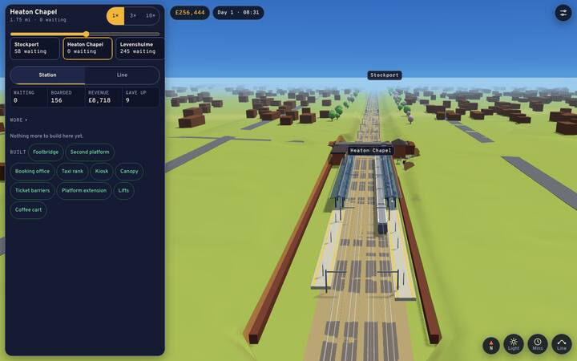

### 6. A raised green slab in Stockport's town, green even in snow
Straight away, to check. Beside the Plaza and the bus depot a flat bright green block stands on a plinth with a few trees on it, and it stays bright green when everything else is under snow. It may be a roof garden or a park on a deck (Merseyway's?), but it reads as a stray slab; if it's grass, it should take the snow like the ground.

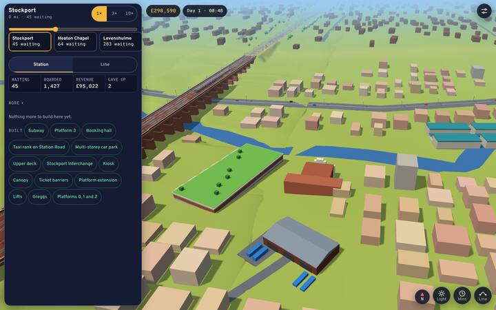

### 7. Hazel Grove's link bus stands on the grass
Closely. With the bus link bought, the bus at Hazel Grove waits on the grass beside the station pad, away from the road and the bus stop.

### 8. A house on Woodsmoor's cutting edge
Closely. A grown home stands right on the top of Woodsmoor's retaining wall beside the platforms, part over the cutting. Homes should keep clear of the station's land.

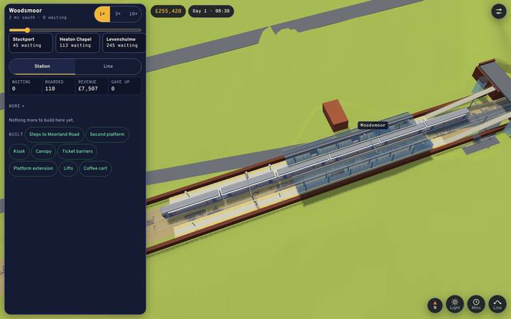

### 9. The coin floats away from the station's name
Closely. The gold coin over the station earning most hangs well to one side of the station's name at Stockport (it follows the kit's origin, and the name sits at the stop), so from above it looks like a stray object over the tracks.

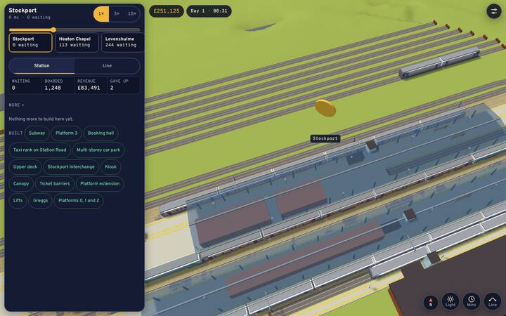

### 10. Station names overlap
Closely. Looking along the Hazel Grove line, Davenport's and Woodsmoor's names sit on top of each other where they line up in the distance; one should give way.

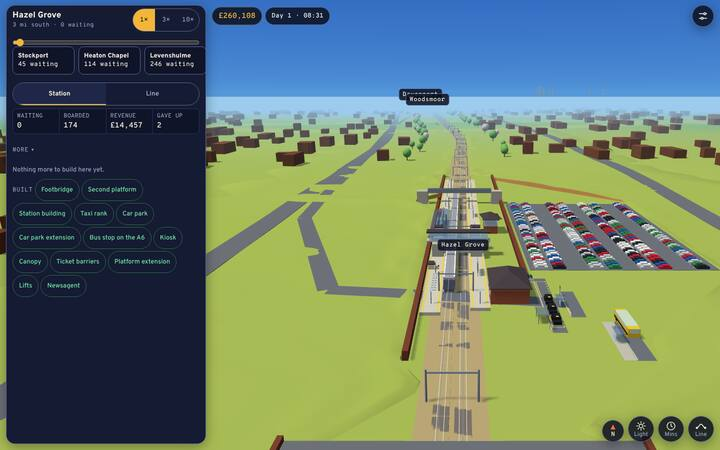

### 11. Patches of green on the city's sand-coloured ground
Closely. Round Ardwick, where the ground turns to the city's sand colour, bright green strips and wedges show along the line's edges and at the station pad, where the fine ground meets the base.

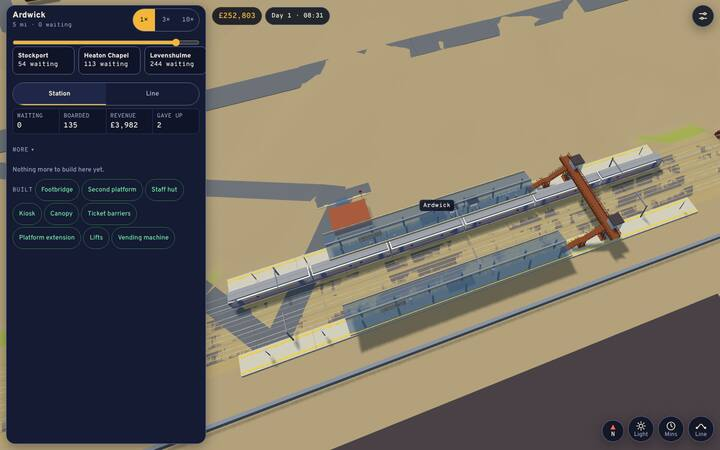

### 12. Half the viaduct's deck is bare, with a strip running off its end
To check. From the deck, the tracks run along one side and the other half is bare brick with a pale strip that carries on past the deck's end into the field. The real viaduct carries the four tracks across its whole width since the 1880s widening; check the deck's width and what the strip is.

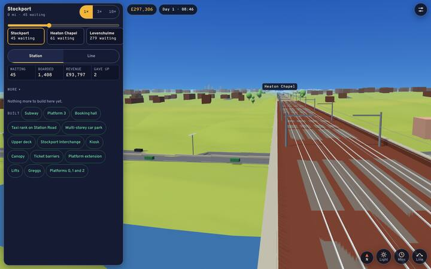

### 13. No engineering train to be seen at night
To check. On a night it runs (day 2, 01:37), with the camera at the place the page gives for it (`__view.life().works`), the fast lines are empty: no yellow train and no beacons. Check whether it is drawn where the page says, and whether it shows from above.

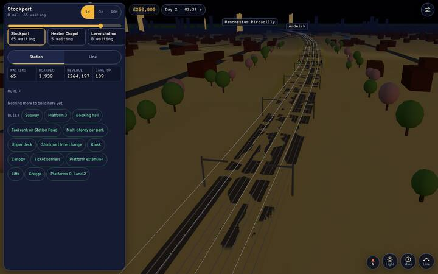

### 14. Bright streaks on the ground
To check. Between Levenshulme and Ardwick, soft light-green bands run across the ground at an angle, like light through a gap; nothing on the map casts them.

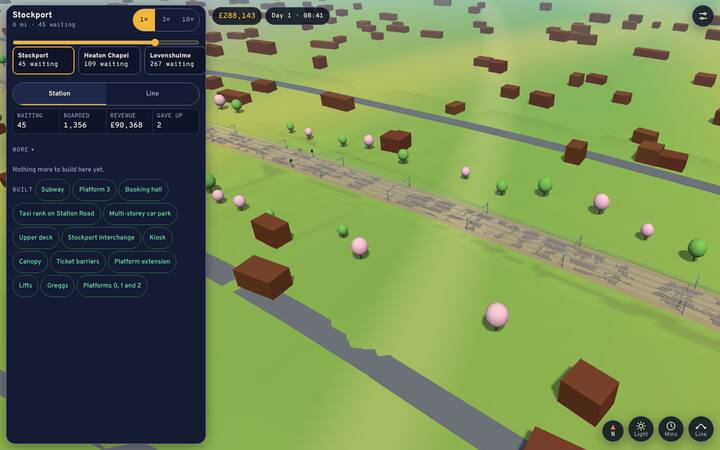

### 15. A dark wedge by Ardwick
To check. North of Ardwick, beside the depot, a long thin dark slanted shape and a pale stripe stick out of the ground at an angle.

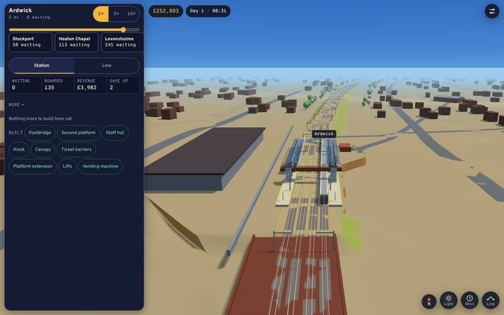

### 16. The night is as light as dusk away from the platforms
To check. At 01:30 the ground and the houses are lit a warm brown, much as at dusk, while the sky is black with stars; the town has no lit windows. The platforms' lamplight and the floodlit viaduct read well. Whether the ground should be darker is a call on looks against playability.

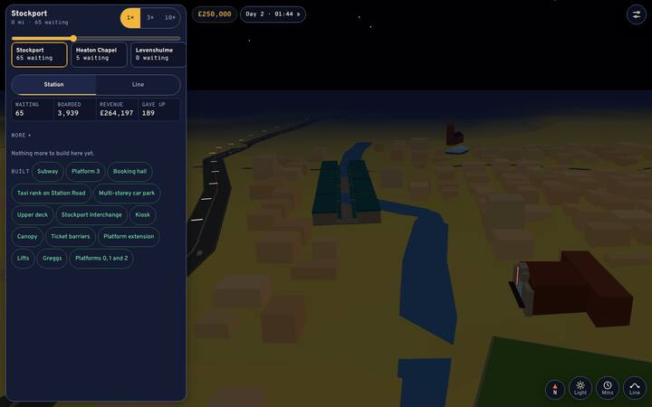

### 17. Stockport's multi-storey car park shows one deck
To check. With the multi-storey car park and its upper deck bought, the car park reads as cars on one raised slab, not a building of several floors. Check against the kit and the photo library.

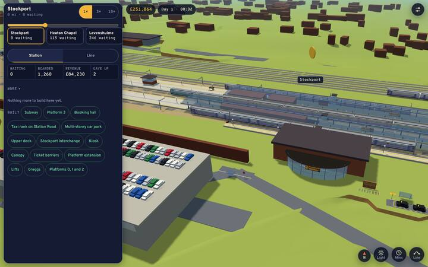

### 18. A road through Levenshulme's station pad
To check. A road runs straight under the middle of Levenshulme's platforms. The A6 does pass under the line at Levenshulme; check it crosses where the real bridge is, and that it shows as passing under rather than through.

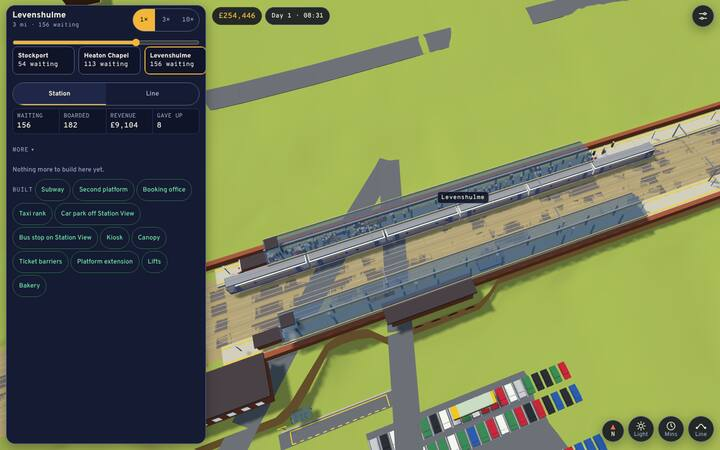

### 19. The raised sheet opens part-scrolled after a pick
To check. After picking a card and closing its Buy bar, raising the sheet shows the list scrolled to that card, with the card above cut through by the tabs. Possibly meant (it keeps the picked card in view).

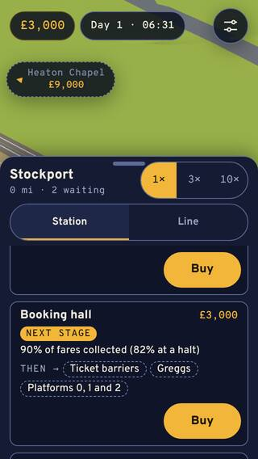

## Looked at and fine

Every station's kit at platform level, the canopies, footbridges and lifts, the six-car units and expresses at their platforms, the taxi ranks, Stockport Interchange's buses, Piccadilly's train shed, rain, snow, fog, dusk and the lamplit platforms, the viaduct floodlit at night, the Pyramid, the M60 and the river, the junctions, and at 320 px the peek, the edge marker, the Buy bar, settings and the contract sheet. The contract's plaque by Stockport's entrance is too small to pick out in these views; the next audit should add a close view of it.

## What the final pass didn't cover

Stopped part-way when the owner wound the sessions down. Not reshot with the real buildings: the landmarks, junctions and skyline (finding 6, the green slab in the town, may have gone with the stand-in town), the line at desktop size, Piccadilly's street and approach views, New Mills Newtown, and the dusk, night, rain, snow and fog sample. The Marple and Rose Hill line was shot at phone size only and not looked at (it's being built). The first pass's shots of all of these were looked at and are the basis of the findings above.

## For the next audit

`node tools/shots.mjs --audit` takes about two hours in a container that draws in software; `station-`, `line- place-` and `ui-` as prefixes run side by side, and `--audit sheets` rebuilds only the contact sheets. Hold the new set view for view against this one.
